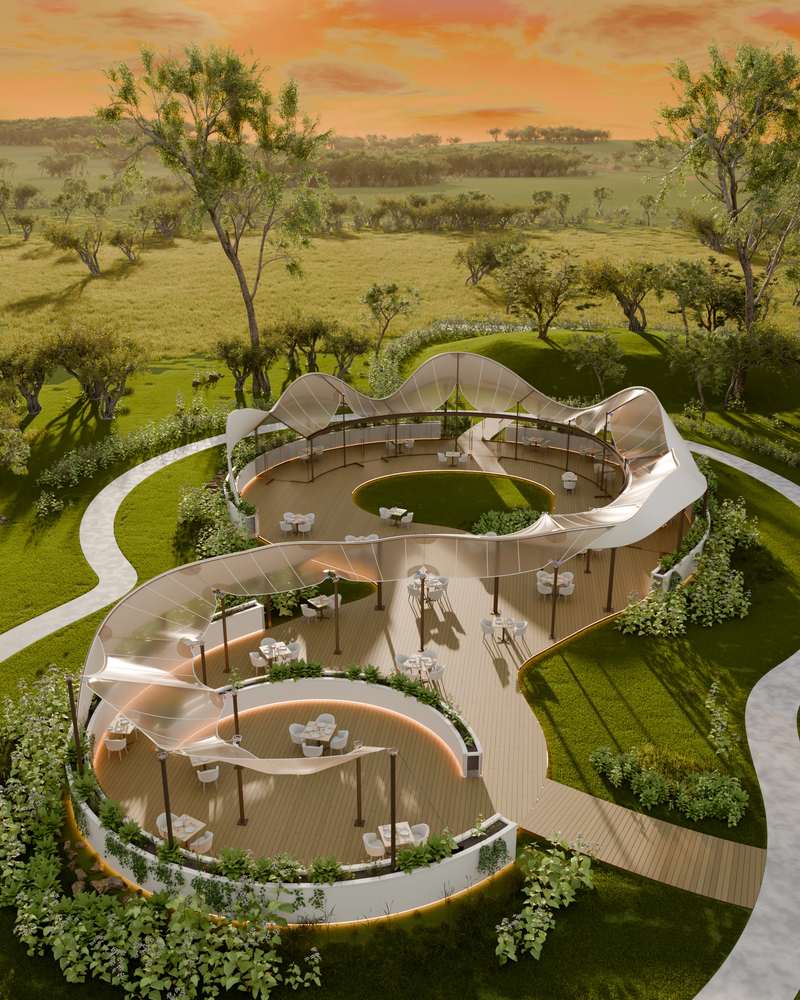

# 栖光之间：自然共生的流动园境

建筑、园林与黄昏光影的三维展示项目。最终版本：C07r12 离线场景 / C09 全场交互网页。



## 完整工程与视频

请打开 [最终交付 Release v1.0.0](https://github.com/Changhongyin/Sensory-Garden-Restaurant/releases/tag/v1.0.0) 下载全部附件。大文件保存在 Release 附件中，确保完整场景和材质不因 Git 单文件限制而被删减。

- [下载完整工程包](https://github.com/Changhongyin/Sensory-Garden-Restaurant/releases/download/v1.0.0/Sensory-Garden-Final-Source.zip)：完整源码与可移植 Blender 工程，内含 `render/Garden_Final_Packed.blend`。
- [下载4K/60fps Demo](https://github.com/Changhongyin/Sensory-Garden-Restaurant/releases/download/v1.0.0/Sensory-Garden-Demo-4K60.mp4)：3840×2160，60fps，40秒，2400个实际三维输出帧。
- `Project-Report.pdf`：11页项目报告。
- `Sensory-Garden-Final-Images.zip`：原生2160×2700、Cycles 256采样全景PNG与线性EXR，以及4K网页画面。
- `SHA256SUMS.txt`：附件校验值。

## 运行交互网页

安装 Python 3.9+ 后，在本仓库目录执行：

```sh
cd web
python3 website-source/c09-viewer/serve.py --port 8809 --open
```

也可进入 `web` 双击适用系统的启动脚本。支持拖动、缩放、机位切换、可中断漫游及原图查看。依赖和三维资源已随仓库保存，无需账号或API密钥。

## 重新渲染

从 Release 的完整工程包解压 `render/Garden_Final_Packed.blend`，放进本仓库的 `render` 目录，使用 Blender 5.2.3 LTS：

```sh
blender -b --python render/render_final.py -- --profile final --threads 8
```

输出原生PNG、线性EXR与运行清单，不覆盖源场景。`final`为2160×2700、256 samples；`ultra`为可选3840×4800、512 samples配置，未宣称已完成该配置。

## 内容与实现

- 透光膜屋顶、透明落地玻璃、浅色陶瓷花池、木平台与完整园境。
- 25组桌位、70个座位；包含家具及餐具细节。
- 草坡、灌木、林带、草甸、河流与低山背景。
- Aholo Lux3D制作部分座椅与植栽初始资产；Blender精修、整合和离线渲染；Three.js提供实时展示。

离线结果与网页材料近似分别说明。视频60fps是输出帧率，实时性能随设备与分辨率变化。本次最终交付聚焦黄昏建筑景观，不含人物或游戏。

## 报告、来源与验证

- [项目报告](docs/Project-Report.pdf)
- [工具和素材来源](metadata/CREDITS.md)
- `metadata/`保留原生渲染、导出与性能记录；`report-source/`保留报告生成源码。
- `manifest.json`记录完整交付源码包的文件校验；其中大体积Blender场景在Release完整包中。

第三方素材及依赖遵循各自许可；未为整个项目额外指定开源许可。用户提供的设计参考仅作为设计输入及过程说明。

## 赛事项目链接

https://github.com/Changhongyin/Sensory-Garden-Restaurant

项目源代码栏选择“填写链接”，填入以上仓库地址即可；完整工程在仓库关联的Release中提供。
